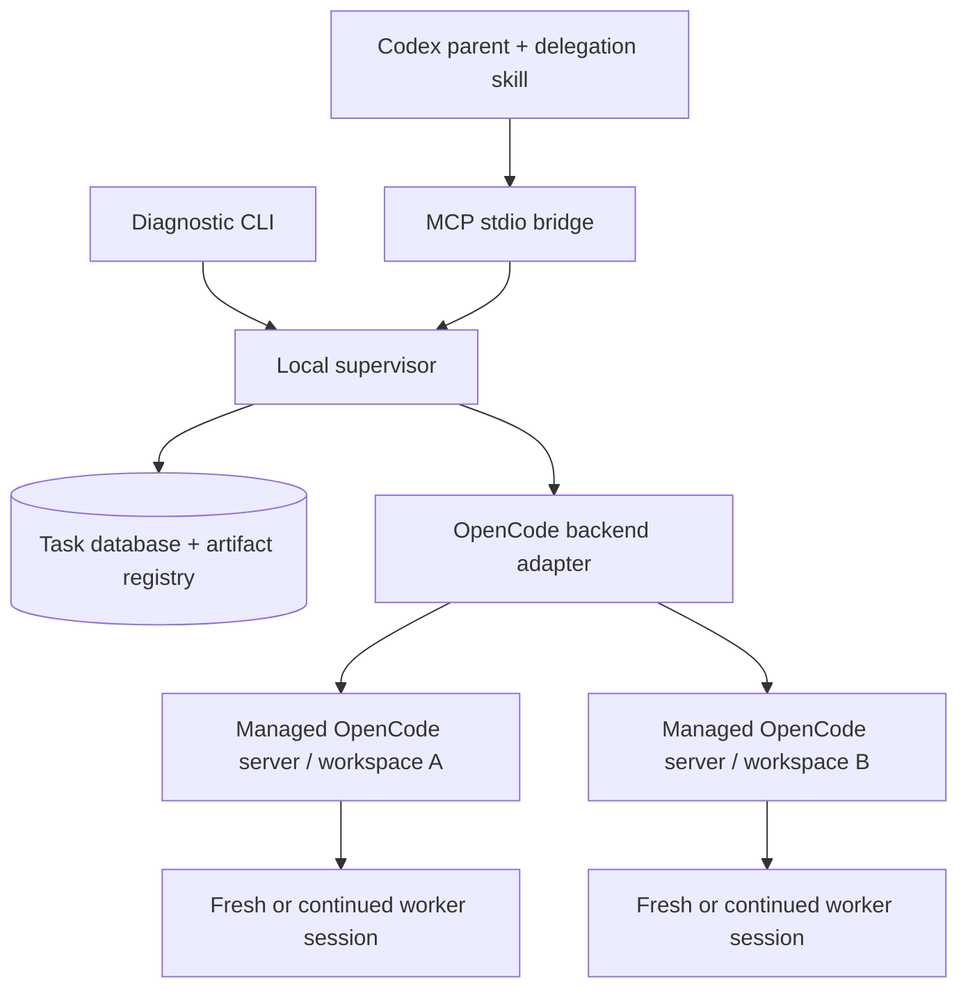

# OpenCode Agents v2 — Product and Technical Specification

**Status:** Proposed implementation specification; no v2 software has been implemented or validated by this document.  
**Date:** October 9, 2026  
**Baseline inspected:** Installed `opencode-agents` plugin 0.1.0 and its Python runner, task templates, orchestration guidance, reporting guidance, and evaluation fixtures.  
**Product identity:** Retain `opencode-agents`. “v2” means the second generation of this toolkit, independently of OpenCode's or the MCP SDK's version numbers. A `2.0.0` toolkit release is proposed to make the breaking runtime and interface changes explicit.

## 1. Decision and intended outcome

Build a TypeScript toolkit running on Node.js. Codex accesses it through a small MCP interface. A local supervisor owns durable task records and coordinates persistent OpenCode HTTP servers. A Codex skill teaches the parent agent when to delegate, how to prepare assignments, and how to verify the results.

The default unit of delegation is **one bounded assignment, one fresh OpenCode session, and one explicitly selected workspace**. Follow-up work can reuse that exact session. Reusing a server never implies reusing a conversation.

The toolkit must let Codex:

1. Start independent work and receive a durable handle promptly.
2. Continue its own work while OpenCode runs.
3. Observe progress and blockers through compact, structured responses.
4. Resume observation after a tool timeout, MCP disconnect, or supervisor restart.
5. Send bounded follow-ups to the correct conversation.
6. Cancel through OpenCode and distinguish a cancellation request from confirmed stopping.
7. Inspect artifacts and record its own acceptance decision.

The change replaces subprocess-based orchestration as the primary integration. The v1 assignment discipline, evidence requirements, and explicit acceptance model remain central.

### 1.1 Success criteria

V2 is ready to release when a parent can run two independent assignments, reconnect while they are running, recover their exact identities, handle an input request, cancel one, continue the other, inspect the outputs, and record a review without duplicate submissions or lost task records. These behaviors must pass deterministic fault-injection tests and a documented real-OpenCode compatibility run.

Neither a successful HTTP response, an idle session, a valid report, nor a worker's claim of completion may independently cause the toolkit to report parent acceptance.

### 1.2 Deliberate scope

Included in 2.0:

- Local stdio MCP server and a diagnostic CLI using the same application services.
- Persistent local supervisor, durable storage, bounded scheduling, and recovery.
- Toolkit-managed OpenCode servers; optional attachment to a configured local server.
- Fresh sessions, exact-session follow-ups, status, waits, cancellation, and input handling.
- Existing directories and pre-created worktrees supplied by the parent.
- Structured worker reports, artifact snapshots, and parent-owned review records.
- Packaged Codex skill, worker profile, templates, and compatibility tests.

Deferred:

- Remote execution, multi-user hosting, public HTTP MCP hosting, and browser dashboards.
- Automatic worktree creation, merge, commit, publication, or checkout cleanup.
- Recursive worker delegation, conversational steering during an active turn, and session forking.
- Automatic model selection, inference retries, failover providers, and exact cost ceilings.
- A general DAG workflow engine, external callbacks, or automatic waking of an idle Codex chat.
- Native Windows certification; initial platforms are macOS, Linux, and WSL2.

## 2. Verified foundations and implementation assumptions

OpenCode exposes a headless HTTP server with sessions, asynchronous prompts, status, messages, cancellation, and event streams. Those are the upstream building blocks; this document defines an additional task-management contract around them. The upstream API includes an OpenAPI description for compatibility inspection. [OpenCode server documentation](https://opencode.ai/docs/server/)

OpenCode provides a typed JavaScript/TypeScript SDK that can connect to an existing server or start one. Use it behind an internal adapter so upstream types and route changes do not become public toolkit contracts. [OpenCode SDK documentation](https://opencode.ai/docs/sdk/)

Codex supports stdio MCP servers. The product therefore starts with a local executable and does not require a remotely hosted MCP endpoint. [Codex MCP documentation](https://learn.chatgpt.com/docs/extend/mcp?surface=cli)

OpenCode also distributes standalone binaries. Node is an explicit toolkit dependency, not a prerequisite that every OpenCode installation already satisfies. [OpenCode installation documentation](https://opencode.ai/docs/#install)

### 2.1 Runtime decisions

| Concern | V2 decision |
| --- | --- |
| Language | TypeScript with strict type checking; compiled ESM JavaScript is published |
| Runtime | Node.js 24.15 or later within the 24.x LTS line initially; additional major versions require certification |
| OpenCode access | Exact, tested `@opencode-ai/sdk` dependency behind `OpenCodeBackend` |
| MCP | Official TypeScript MCP server SDK; stdio transport |
| Schemas | Zod plus generated JSON Schema; one source for runtime validation and tool schemas |
| Durable storage | SQLite through `node:sqlite`, behind a `TaskStore` interface |
| Bulk content | Files outside the database, registered by ID and content hash |
| Packaging | One npm executable plus a Codex plugin containing the skill and the matching compiled runtime |
| Inference | Independently installed and configured OpenCode; no provider credential setup or model downloads |

The current MCP TypeScript SDK uses the `@modelcontextprotocol/server` package for servers. Pin the tested release and the negotiated protocol versions; do not copy imports from older SDK examples without checking them. [Official MCP TypeScript SDK](https://github.com/modelcontextprotocol/typescript-sdk)

Node's SQLite module is documented as release-candidate stability in Node 24.15 and later. The choice avoids a separate native npm add-on, but requires tests against the minimum supported Node patch and current supported 24.x patch. Keep SQLite access small and replaceable. [Node 24 SQLite documentation](https://nodejs.org/download/release/latest-v24.x/docs/api/sqlite.html)

### 2.2 Upstream compatibility policy

The locally observed OpenCode version was 1.18.35. Only its version and CLI help were checked in this conversation; this is **not server compatibility certification**.

Before implementing the full runtime, certify one exact OpenCode/SDK pair against a disposable project. Record:

- Binary, SDK, Node, and toolkit versions; server API fingerprint.
- Session creation and lookup, explicit workspace routing, and message identifiers.
- Asynchronous submission, terminal-message interpretation, errors, and session status.
- Pending permission enumeration, request replies, and cancellation behavior.
- SSE reconnect behavior and recovery without assuming event replay.
- Effective worker permissions, project configuration, and external-plugin behavior.
- Session persistence and retrieval after a server restart.
- Native questions if enabled; otherwise confirm that the question tool is disabled.

Publish the supported pairs in `compatibility.json`. Unsupported versions may run read-only diagnostics, but execution requires an explicitly supported backend adapter. A newer version string alone does not prove compatibility. Toolkit v2 must not accidentally assume that OpenCode's separate v2 APIs match its older APIs.

### 2.3 Internal backend contract

Keep upstream SDK types private to the adapter. The application core depends on a normalized interface with these operations:

| Operation | Contract |
| --- | --- |
| `inspectBackend` | Return version, identity, workspace binding, effective configuration digest, and capabilities |
| `createSession` | Create a session with a persisted correlation marker; return its exact identity |
| `findCreatedSession` | Reconcile an ambiguous creation intent within the recorded backend/workspace |
| `submitTurn` | Submit the frozen prompt with recorded correlation IDs; return acknowledgement, not task success |
| `inspectTurn` | Correlate messages, active tools, status, errors, and pending requests for one execution |
| `subscribeEvents` | Yield normalized observations; report stream gaps and disconnects |
| `replyToRequest` | Reply to one current permission/question using its upstream identifier |
| `abortSession` | Request stopping and return acknowledgement separately from confirmed stop evidence |
| `readResult` | Retrieve the relevant final response/structured output without a new model call |

All operations accept cancellation/deadline controls for the individual network request. Aborting that request never implies aborting the upstream execution. Capabilities explicitly include caller-assigned message IDs, permission enumeration/reply, question handling, structured output, and session recovery. The core must not infer capabilities from the existence of an SDK method alone.

## 3. Architecture and ownership



All runtime components ship in one package. The supervisor is a separate process because worker ownership, monitoring, and deadlines must survive the lifetime of an individual MCP connection. It is an implementation detail of the toolkit, not another product the user must separately install.

| Component | Responsibility |
| --- | --- |
| Codex parent | Decomposition, scope, model/profile choice, authorization context, workspace preparation, verification, integration, acceptance |
| Codex skill | Teach the parent the delegation workflow and context/reporting conventions |
| MCP bridge | Validate protocol input, identify coordination scope, forward operations, format bounded responses |
| Supervisor | Single writer, admission, dispatch, event consumption, deadlines, recovery, snapshots, and backend lifecycle |
| Backend adapter | Translate toolkit operations into the certified upstream API and normalize upstream observations |
| OpenCode server | Run worker conversations and tools; persist upstream sessions according to OpenCode behavior |
| Worker profile | Execute the bounded assignment and return evidence, coverage, gaps, and actual check results |

### 3.1 Process lifetime

1. The MCP executable starts quickly and connects to the local supervisor.
2. If necessary, it launches the supervisor without model inference. Server startup is lazy and happens when an assignment is admitted.
3. Closing an MCP connection only closes that client's observation requests. It does not cancel accepted jobs.
4. The supervisor stays alive while jobs are queued, active, waiting for input, or operationally unresolved.
5. Managed OpenCode servers remain warm for 15 minutes after their last operationally resolved execution. Their session storage is preserved when the process exits.
6. With no clients, jobs, unresolved cancellations, or managed servers, the supervisor may exit after 15 minutes of inactivity.

On startup, the supervisor must reconcile durable records before dispatching new work. Starting an empty supervisor does not permit it to ignore existing sessions or locks.

### 3.2 Supervisor identity and local transport

Use a Unix-domain socket inside a private runtime directory on supported POSIX platforms. Authenticate clients with a random local token stored outside worker workspaces. A per-start supervisor generation ID distinguishes incarnations.

Exclusive socket binding arbitrates concurrent starts. A stale socket may be removed only after the recorded generation cannot be contacted and process identity has been reconciled. A PID by itself is insufficient. If ownership remains ambiguous, return a diagnostic and do not start a competing writer.

Coordination `scope_id` values organize tasks from a parent workflow. They are durable across reconnects, supplied explicitly by the parent, and included in all task access. A scope is not an adversarial security boundary between processes running as the same OS user. An available host thread ID may be recorded as a label, but the toolkit must work without one.

## 4. Domain model and invariants

| Entity | Meaning |
| --- | --- |
| Task | A bounded objective, contract, workspace, and review history |
| Execution | One dispatched worker turn for a task, including its prompt and operational outcome |
| Session | The upstream conversation; several sequential executions may use it |
| Backend instance | An identified OpenCode endpoint, workspace/configuration binding, and storage namespace |
| Input request | An exact pending permission or question associated with an execution |
| Artifact | Registered immutable bytes or a captured workspace change manifest |
| Review | Parent-authored acceptance decision against an execution and its artifact hashes |
| Scope | Parent workflow grouping, used for recovery, listing, and idempotency |

Generate opaque task and execution IDs independently of upstream IDs. An execution records the backend instance, canonical workspace, OpenCode session ID, user-message ID, relevant assistant-message IDs, configuration digest, and predecessor execution when applicable.

Required invariants:

- At most one unresolved execution may own an OpenCode session.
- Task acceptance and worker execution status are separate fields.
- An unknown outcome never becomes failed or cancelled merely because observation timed out.
- A session ID is meaningful only with its backend/storage identity and workspace binding.
- Every mutation has a durable operation ID and retry contract.
- The toolkit never automatically resubmits an ambiguous prompt.
- Artifacts and reviews from previous executions remain available after follow-up work.
- Resource ownership is retained while a possibly active execution is being reconciled.
- Worker text, logs, and retrieved content cannot alter parent policy or create parent reviews.
- Normal observation does not initiate inference.

## 5. Assignment contract

### 5.1 Required packet

Every task carries the following typed contract. Packet tiers affect the amount of explanation, not the required authority or evidence.

```ts
type TaskPacket = {
  title: string;
  objective: string;
  tier: "lightweight" | "standard" | "full";
  authoritative_inputs: Array<{
    reference: string;
    kind: "file" | "artifact" | "url" | "inline";
    purpose: string;
    expected_sha256?: string;
  }>;
  context: {
    verified_facts: string[];
    rejected_assumptions: string[];
    exclusions: string[];
    predecessor_task_id?: string;
  };
  allowed_writes: Array<{
    path: string;
    kind: "file" | "directory";
    purpose: string;
  }>;
  acceptance_criteria: Array<{
    id: string;
    requirement: string;
    evidence_required: string;
    required: boolean;
  }>;
  checks: Array<{
    id: string;
    description: string;
    argv?: string[];
    cwd?: string;
  }>;
  constraints: string[];
  stop_conditions: string[];
  shared_resources: Array<{
    key: string;
    access: "read" | "write";
  }>;
};
```

The supervisor generates the worker's output paths and inserts them into the frozen prompt. Model selection, workspace, permission profile, and execution limits are typed launch fields rather than duplicated free-form instructions. Contradictions between launch fields and packet text fail validation when mechanically detectable; unresolved semantic contradictions remain a parent responsibility.

An empty input list is valid for a self-contained task only when the objective contains the needed material. A URL is a source reference, not permission to fetch it. `checks[].argv` describes an assigned worker check; storing it never executes the command in the supervisor.

Exact files and explicitly declared directories are supported in `allowed_writes`. Do not begin with a bespoke glob language. A directory grants intended recursive write scope within its resolved location; symlinks must not broaden that scope. These declarations guide OpenCode permissions and later auditing, and are not a filesystem sandbox.

### 5.2 Workspace and starting state

The caller supplies an absolute existing workspace path. The toolkit resolves it to a canonical path and validates it against configured project roots. Relative paths in the packet resolve against that workspace, never the MCP process's launch directory.

For Git workspaces record HEAD, repository identity, canonical worktree path, tracked dirty diff, staged state, and the names/hashes of relevant untracked inputs. A commit ID alone is insufficient. Explicitly listed mutable file inputs are hashed, including inputs outside the worktree that are within configured read roots.

For non-Git workspaces record a manifest of declared inputs and write targets. Report the bounds of that manifest; do not claim to have captured the entire directory.

Large or sensitive ignored content is not swept into a snapshot automatically. If an assignment depends on it, declare the specific input and capture its hash under the configured read policy. Snapshot exclusions remain visible as coverage gaps.

Before queued work is dispatched, compare the captured baseline with current relevant inputs. A mismatch fails that execution with `STALE_INPUT`; it does not silently replace the assignment's baseline. A new, explicitly prepared execution may use the changed inputs.

### 5.3 Frozen prompts

Render a deterministic prompt from the packet, selected worker profile, execution ID, starting-state manifest, and output contract. Save the exact bytes and SHA-256 digest before dispatch.

The prompt must distinguish authoritative sources from generated interpretations. Independent reviews omit earlier verdicts. Follow-ups include the requested correction, changed inputs, verified findings, rejected assumptions, and remaining criteria. Do not copy the entire parent conversation by default.

## 6. Operational state and completion

### 6.1 Execution phases

| Phase | Meaning |
| --- | --- |
| `queued` | Accepted locally; waiting for capacity/resources; no worker prompt dispatched |
| `dispatching` | Preparing the backend/session or attempting the recorded prompt submission |
| `running` | Matching execution is active upstream |
| `waiting_input` | Matching pending permission/question needs a response |
| `cancelling` | A stop request exists; stopping has not yet been confirmed |
| `finalizing` | Stopping is confirmed; reports and workspace evidence are being captured |
| `completed` | Matching turn ended normally and no matching tools remain active |
| `failed` | A known operational failure ended or prevented this execution |
| `cancelled` | User/parent cancellation has been operationally confirmed |
| `timed_out` | An execution deadline caused a confirmed stop, or a queued execution expired before dispatch |

`observation` is separately `current`, `reconciling`, or `unknown`. An execution may have `phase: running, observation: unknown`; that is not a terminal result. Every response includes `terminal` and `operationally_resolved`, derived from confirmed facts rather than inferred from the phase label alone. In `finalizing`, upstream work is operationally resolved but the toolkit execution is not yet terminal. Capture failures end finalization with explicit missing/invalid evidence; they cannot leave a task finalizing indefinitely.

Main transitions:

```text
queued -> dispatching -> running <-> waiting_input
queued -> cancelled | timed_out | failed
dispatching -> running | waiting_input | failed | cancelling
running | waiting_input -> finalizing | cancelling
cancelling -> finalizing
finalizing -> completed | failed | cancelled | timed_out
```

The intended terminal outcome is recorded when stopping is confirmed. Finalization preserves a normal completion or failure racing with cancellation and records whether cancellation actually took effect. A known dispatch failure before any prompt submission may terminate directly; an ambiguous dispatch may not.

### 6.2 Evidence of completion

The backend adapter must correlate the submitted user message with its assistant turn, terminal/error markers, active tool state, pending requests, and session status. An idle signal alone is insufficient, especially immediately after async submission. A `step_finish` event is not task completion.

After the turn stops, the supervisor ingests and freezes any required reports, captures the workspace change manifest, and validates artifact structure. Report validity is represented separately as `pending`, `valid`, `missing`, or `invalid`. Normal execution with a missing report can be `completed` while remaining unacceptable. Finalization has a configurable 60-second default deadline; on expiry it records exactly which evidence was not captured and publishes the known operational outcome. Workspace reservations remain held until capture finishes or its failure is durably recorded.

Worker assessment is a separate value: `completed`, `partial`, `blocked`, or `no_supported_finding`. Parent review is another: `pending`, `accepted`, `needs_correction`, `rejected`, or `awaiting_evidence`.

No automatic inference is performed to summarize logs, repair reports, or decide acceptance.

## 7. MCP interface

Use the `opencode_` prefix. Keep schemas strict, reject unknown input fields, and supply both structured content and a short readable description. Bulk text is retrieved separately.

### 7.1 Shared conventions

- IDs are opaque, nonempty strings; timestamps are UTC RFC 3339.
- Every mutation requires a caller-generated `idempotency_key` of 16–128 characters. Keys are scoped by coordination scope and operation name.
- Updates to existing tasks/requests require `expected_revision` to reject stale decisions. `get_task` returns the current revision.
- The same key and canonical semantic payload returns the same operation identities and current status. Reusing a key with a changed payload returns `IDEMPOTENCY_CONFLICT`.
- Resolve a duplicate operation before rejecting an old `expected_revision`; retrying the exact original mutation must remain safe.
- `dry_run` is available on `start_task`; it allocates no IDs, persists no task, and starts no backend or inference. It needs no idempotency key and returns known checks plus `unchecked` backend capabilities.
- Start/continue return after durable acceptance, not after model completion.
- Tool transport cancellation only stops that tool call. Use `cancel_task` to cancel work.
- Normal responses target 8 KiB maximum. Essential state, IDs, blockers, errors, and cursors are never silently truncated.
- Packet input is limited to 128 KiB; larger context uses declared files/artifacts. Bounds are measured in UTF-8 bytes.

### 7.2 Tool catalog

| Tool | Inputs | Result and behavior |
| --- | --- | --- |
| `opencode_health` | Optional configured backend ID | Runtime versions, supervisor state, supported capabilities, backend health, queue counts, storage health; no inference |
| `opencode_start_task` | `scope_id`, packet, workspace, model selection, profile, limits, idempotency key; optional `dry_run` | Validated plan or durable task/execution IDs, revision, queue position, and status |
| `opencode_get_task` | `scope_id`, `task_id`, optional `execution_id`, optional `after_cursor` | Current compact state, new material events, worker assessment, report validity, review status, pending requests, artifact references |
| `opencode_list_tasks` | `scope_id`, optional state filters, `limit` 1–100 default 20, opaque page cursor | Recoverable task inventory; no raw prompts or worker logs |
| `opencode_wait_tasks` | `scope_id`, 1–16 targets with per-target cursors, `timeout_ms` 0–30,000 default 20,000 | Returns on a material change to any target or timeout; includes compact states and new cursors |
| `opencode_continue_task` | `scope_id`, `task_id`, predecessor execution, expected revision, follow-up packet fields, context mode, idempotency key | Creates a new execution; either reuses the recorded session or creates fresh context as specified |
| `opencode_cancel_task` | `scope_id`, task/execution IDs, reason, expected revision, idempotency key | Returns stop-request status promptly; only confirmed evidence yields a terminal cancellation |
| `opencode_respond_to_request` | Scope, task/execution IDs, exact request ID/revision, reply, authorization basis, idempotency key | Records and submits a response to a current request; does not expand task scope |
| `opencode_read_artifact` | Scope, task/execution IDs, artifact ID, optional byte offset, `max_bytes` 1–65,536 default 16,384 | Bounded UTF-8 content, hash, size, and continuation offset; binary artifacts return metadata/path |
| `opencode_record_review` | Scope, task/execution IDs, expected revision, disposition, criteria/evidence, observed manifest hash, idempotency key | Appends parent review; refuses stale evidence and structurally incomplete acceptance |

`health`, `get_task`, `list_tasks`, `wait_tasks`, and `read_artifact` are annotated read-only. Starting, continuing, cancelling, responding, and recording reviews are mutations even when some paths are harmless or idempotent. Do not label launch tools read-only to obtain easier host approval.

### 7.3 Start example

The following is an illustrative request using fictional workspace and provider values. It is not a command to run as part of this specification.

```json
{
  "scope_id": "coord_example_001",
  "idempotency_key": "start-retry-fix-0001",
  "workspace": {
    "path": "/projects/example-retry-worktree",
    "access": "exclusive"
  },
  "model": {
    "provider_id": "configured-provider",
    "model_id": "configured-model"
  },
  "profile": "bounded-build",
  "limits": {
    "queue_timeout_seconds": 600,
    "execution_timeout_seconds": 1800
  },
  "packet": {
    "title": "Clamp retry delay",
    "objective": "Implement the documented upper bound for retry delays.",
    "tier": "standard",
    "authoritative_inputs": [
      {"reference": "src/retry.ts", "kind": "file", "purpose": "Implementation"},
      {"reference": "test/retry.test.ts", "kind": "file", "purpose": "Behavior contract"}
    ],
    "context": {"verified_facts": [], "rejected_assumptions": [], "exclusions": ["No retry-policy redesign"]},
    "allowed_writes": [
      {"path": "src/retry.ts", "kind": "file", "purpose": "Fix"},
      {"path": "test/retry.test.ts", "kind": "file", "purpose": "Regression coverage"}
    ],
    "acceptance_criteria": [
      {"id": "cap", "requirement": "Delay never exceeds the configured maximum", "evidence_required": "Boundary test and implementation", "required": true}
    ],
    "checks": [
      {"id": "retry-tests", "description": "Run retry tests", "argv": ["npm", "test", "--", "retry"]}
    ],
    "constraints": ["Preserve unrelated changes"],
    "stop_conditions": ["Report a need to change the public retry contract"],
    "shared_resources": []
  }
}
```

The result contains `task_id`, `execution_id`, `revision`, `phase`, `observation`, and `operationally_resolved`. It must not claim that work has begun while it is merely queued.

### 7.4 Follow-up rules

`continue_task.context_mode` is `resume` or `fresh`. Both create a new execution and new report locations. `resume` uses the previously recorded backend/session/workspace tuple; it never accepts an arbitrary session ID supplied by the model.

The predecessor must be both terminal and operationally resolved, not merely quiet or still finalizing evidence. There may be no pending permission, active turn, or unresolved cancellation. Any earlier parent acceptance remains attached to that earlier execution; the new execution starts with review `pending`.

A fresh follow-up preserves the task objective but supplies a curated handoff. Changes to the objective, workspace, provider destination, or permission profile require a new task linked through `predecessor_task_id`. V2 does not silently broaden an existing contract.

### 7.5 Errors

Use a stable error object:

```ts
type ToolkitError = {
  code: string;
  message: string;
  operation_id?: string;
  task_id?: string;
  execution_id?: string;
  retry: "safe_same_key" | "observe_first" | "change_input" | "operator_action";
  details: Record<string, unknown>;
};
```

Required codes include `INVALID_INPUT`, `OUTSIDE_CONFIGURED_ROOT`, `UNSUPPORTED_BACKEND`, `BACKEND_UNAVAILABLE`, `POLICY_MISMATCH`, `STALE_INPUT`, `STALE_REVISION`, `IDEMPOTENCY_CONFLICT`, `SESSION_BUSY`, `AMBIGUOUS_DISPATCH`, `REQUEST_EXPIRED`, `ARTIFACT_CHANGED`, `STORAGE_UNAVAILABLE`, and `UNCONFIRMED_STOP`.

Errors returned after durable admission include recoverable IDs. Do not return a generic failure that encourages the caller to create a replacement task.

## 8. Dispatch, idempotency, and crash recovery

### 8.1 Normal dispatch

1. Validate launch input and policy, resolve paths, and capture the initial contract/baseline.
2. In one transaction, reserve the idempotency key and create the task, execution, and queued event.
3. Return the durable handle to the caller.
4. When capacity and resources are available, acquire their reservations transactionally and recheck input freshness.
5. Resolve or start the compatible backend instance. Verify effective workspace, provider/profile binding, and version.
6. Create a fresh session, or reconcile the exact session for a follow-up.
7. Persist session identity, intended user-message ID, prompt hash, and dispatch intent before submitting the prompt.
8. Submit asynchronously through the backend adapter. Persist acknowledgement if received.
9. Consume events and reconcile status/messages until a confirmed operational result exists.
10. Freeze artifacts, publish the final operational snapshot, and release resources only when stopping is known.

### 8.2 Guarantee boundary

The toolkit guarantees local idempotency and durable dispatch intent. It **does not claim universal exactly-once inference**: a crash can occur after an upstream request is accepted but before its acknowledgement is recorded.

When supported by the certified backend, use a caller-assigned upstream message ID to locate the intended submission. Do not assume that accepting a message ID means the endpoint deduplicates submissions. That behavior must be tested independently.

After ambiguous submission, look up the exact recorded session/message and reconcile its state. If delivery remains uncertain, mark observation unknown, retain reservations, and require reconciliation. Do not invent a new message ID or session to retry the work.

Session creation has its own ambiguity window. Persist a creation intent and a unique toolkit correlation marker before creation; recover through an exact matching marker and workspace/backend binding. Multiple or incomplete matches remain ambiguous. Never select the most recently created session as a substitute.

### 8.3 Recovery matrix

| Failure | Required behavior |
| --- | --- |
| MCP connection closes | Supervisor continues; caller reconnects and retrieves tasks by scope |
| `wait_tasks` expires | Return `timed_out: true` for the wait only; execution is unchanged |
| Start response is lost | Same idempotency key retrieves the admitted task |
| Supervisor restarts | Read stored intents, identify backend incarnations, reconcile sessions, then admit new work |
| SSE disconnects | Reconnect with backoff, read current status/messages/pending requests, and note any unrecoverable progress gap |
| Backend process restarts | Verify the same storage/workspace identity; inspect recorded sessions before deciding an outcome |
| Backend disappears | Mark observation unknown; do not immediately release workspace ownership |
| Report file is malformed | Preserve bytes, record `invalid`, and request parent correction if needed |
| Database write fails | Stop admission/dispatch; expose storage failure and avoid unrecorded work |
| Disk fills during execution | Attempt an auditable stop; expose observation/stop uncertainty if records cannot be persisted |

Retries of read-only observation use capped exponential backoff, for example 1, 2, 4, 8, then 15 seconds with jitter. After 60 seconds of unsuccessful reconciliation, surface a material attention event; continue background checks at 30-second intervals. Reconnection must not automatically trigger inference or reset the execution deadline.

## 9. Server, workspace, and configuration binding

### 9.1 Managed mode — default

The supervisor launches the independently installed OpenCode binary as a headless server using a structured argument list, never shell interpolation. Bind to loopback and use a toolkit-generated per-instance password. Store credential references privately and exclude secrets from prompts, logs, and ordinary tool responses.

Pool servers by canonical workspace plus effective configuration digest. This favors predictable project configuration and avoids changing a shared server's global configuration while another task is running. Idle sessions persist in OpenCode's storage; keeping a process warm is an optimization, not the persistence mechanism.

The managed worker profile/configuration must:

- Preserve the selected provider's configured credentials and destination.
- Pin the chosen model/profile for each execution.
- Apply the bounded worker tool permissions.
- Disable toolkit recursion and unapproved external plugins.
- Exclude the parent-facing toolkit MCP server from worker access.
- Respect applicable project guidance while refusing configuration that broadens the declared worker policy.

V1 uses `run --pure`. V2 must verify the equivalent external-plugin suppression behavior for the selected server version; it cannot assume that a run-mode flag has identical server-mode behavior. If effective policy cannot be established, execution fails with `POLICY_MISMATCH`.

### 9.2 Attached mode

An operator may configure an existing local OpenCode endpoint. V2 supports only explicitly configured loopback endpoints; it does not accept arbitrary URLs from task prompts.

The toolkit must establish the server's identity, workspace routing, storage namespace, and effective worker policy. It must not patch global configuration or kill the attached server. If an attached instance cannot meet the same execution contract, diagnostics remain available but task dispatch is refused.

Attaching does not grant access to arbitrary historical sessions. Only sessions created by the toolkit or explicitly imported through the migration workflow may be continued.

### 9.3 Configuration changes

Hash behavior-relevant configuration and record the digest for each execution. Changing the configured endpoint, agent permissions, provider routing, plugins, or model profile creates a new configuration generation. Existing executions keep their recorded generation; the toolkit does not silently migrate them.

Record model IDs and a sanitized destination identity. Model names alone do not identify where data is sent. Unknown or unavailable token/cost usage is `null`, not zero. No fallback provider is selected automatically.

## 10. Scheduling and resource ownership

Default limits:

| Setting | Default |
| --- | --- |
| Concurrent admitted executions per supervisor | 2 |
| Concurrent admitted executions per provider profile | 2, capped by the global limit |
| Concurrent unresolved executions per session | 1 |
| Workspace mode | Exclusive |
| Queue timeout | 600 seconds |
| Execution timeout | 1,800 seconds from resource admission, including backend preparation and worker time |
| Cancellation confirmation target | 10 seconds; uncertainty remains visible beyond this |
| Wait call maximum | 30 seconds |

Admission is FIFO among eligible queued tasks; an older task waiting for one resource does not block unrelated eligible tasks. Acquire all task resource reservations atomically, or none. Active, waiting-input, cancelling, finalizing, and unresolved executions retain their reservations and capacity slots. Queued tasks hold no execution resources.

The execution deadline includes server startup, active work, permission waits, and question waits. Queued time uses its separate deadline. A silent log is not an execution timeout and does not justify cancellation on its own.

Persist admission time and an absolute deadline; use monotonic elapsed time during an uninterrupted supervisor lifetime. Restart, reconnect, or a backward wall-clock adjustment must not grant a fresh full timeout. Record clock uncertainty and reconcile conservatively after a restart. Limits are positive integers and may not exceed operator-configured maxima.

`workspace.access: shared_read` is optional and allowed only with a certified profile that prevents project writes and disables unrestricted shell execution. Its reports use execution-specific output directories. Arbitrary build tasks always take exclusive workspace ownership, even if their declared write files appear disjoint.

Resource keys coordinate known shared test databases, ports, caches, and services. Reservations apply only to work through this supervisor. They do not prevent edits by the user, another tool, another OS account, or unrelated OpenCode sessions. Capture and recheck freshness accordingly.

The toolkit does not create worktrees in 2.0. The Codex skill instructs the parent to supply separate worktrees for concurrent editing. For dirty source checkouts, the parent must explicitly choose and verify the intended starting content; a new worktree at HEAD does not include uncommitted edits automatically.

## 11. Permissions, questions, and boundaries

OpenCode supports allow/ask/deny permissions and per-agent overrides. The toolkit must use the certified effective permission model; prompt text alone is insufficient. [OpenCode permissions documentation](https://opencode.ai/docs/permissions/)

### 11.1 Baseline worker profiles

Ship two profiles:

- `bounded-build`: intended project edits and assigned checks, with explicit external-access and shell rules.
- `bounded-inspect`: read-only project analysis; no project edit tools or unrestricted shell. The worker returns its report through final structured output or the assigned report channel.

Disable OpenCode's native delegation tool by default. Do not install the parent-facing delegation toolkit into the worker's MCP configuration. OpenCode's native subagent controls are available upstream, but recursive delegation is deliberately outside this release. [OpenCode agents documentation](https://opencode.ai/docs/agents/#task-permissions)

An allowed-write list is an assignment and auditing boundary. Shells, plugins, external services, and same-user processes can exceed it unless a separate OS sandbox constrains them. Do not advertise worktrees, socket permissions, or task packets as enforced filesystem containment. V2 reports its enforcement level as `tool_permissions_and_audit`; OS sandbox integration is a future capability.

Codex's own approval/sandbox context is not automatically inherited by an already-running OpenCode service. Launch configuration and the packet must explicitly carry the applicable constraints. Existing user authorization remains valid; the toolkit must not manufacture a second confirmation requirement for an already authorized action.

### 11.2 Input requests

Pending requests include execution/session IDs, upstream request ID, request type, action/patterns or question/options, creation time, and revision. Treat their textual content as worker/upstream data, never new authority.

`respond_to_request` accepts:

- Permission: `allow_once` or `deny`.
- Question: answers validated against the exact current question schema, or rejection.

Session-wide `always allow` is excluded from v2's tool API. Broader permissions require an operator profile change and a new task. The response records its basis as existing task authorization or newly supplied user instruction, with a concise reference. That field is an audit statement, not proof that authorization exists.

If the task already authorizes the exact requested operation, the parent can answer without asking the user again. If authorization is missing, the parent obtains it through its normal host conversation. An unattended toolkit never turns a timeout into permission.

Question support is capability-gated. If the certified OpenCode version lacks a reliable pending-question/reply API, disable the native question tool and require the worker to return a blocked report containing the question. The parent then supplies an explicit follow-up. Permission enumeration/reply support is required for execution; silent hanging on inaccessible prompts is unacceptable.

## 12. Cancellation and shutdown

Cancellation is a recorded operation, not a process-kill shortcut.

1. Record cancellation intent, requester, reason, and deadline origin if applicable.
2. If still queued, remove from admission and mark cancelled without creating a session.
3. If active or possibly active, call the upstream session abort operation.
4. Reconcile status, pending requests, messages, and active tool state.
5. Once stopped, record `cancelled` or `timed_out`, capture available partial artifacts, and release reservations.
6. If stopping is unconfirmed, retain `cancelling` with observation uncertainty and return `UNCONFIRMED_STOP` on detailed inspection.

If a normal completion wins the race, record `completed` plus `cancel_effect: not_applied`; do not overwrite successful completion with an invented cancellation.

Cancel acknowledgement does not imply rollback of edits, cancellation of remote provider billing, or termination of detached external services. State these limits in the detailed cancellation result when relevant.

The MCP interface cannot kill an entire server. A diagnostic CLI may stop a managed instance only after verifying ownership and reconciling all affected sessions. It must never kill an attached server or a process identified only by a historical PID.

`daemon stop` drains by default: stop admission and wait for active jobs. An explicit cancellation option requests cancellation of active jobs before shutdown. Deadline/stop uncertainty is reported rather than hidden by forced process exit. OS login-service installation is not automatic.

## 13. Reports, artifacts, and parent review

### 13.1 Worker report

Require one machine-readable report with a readable summary:

```ts
type WorkerReport = {
  schema_version: 2;
  task_id: string;
  execution_id: string;
  outcome: "completed" | "partial" | "blocked" | "no_supported_finding";
  summary: string;
  coverage: string[];
  gaps: string[];
  findings: Array<{
    id: string;
    claim: string;
    evidence: string[];
    caveats: string[];
  }>;
  changes: Array<{ path: string; description: string }>;
  checks: Array<{
    id: string;
    status: "passed" | "failed" | "not_run";
    exit_code: number | null;
    evidence: string[];
    explanation: string;
  }>;
  blockers: string[];
  next_action: string;
};
```

Use final structured output when supported by the certified backend; otherwise write `result.json` and `summary.md` in the execution's assigned output directory. In both cases the supervisor ingests the exact bytes into its immutable artifact store. Profile-specific permissions must actually permit the chosen report channel.

Summary targets remain 150/250/400 words for lightweight/standard/full packets. These are soft targets. Material caveats, failed checks, contradictions, and coverage gaps must survive summarization. A no-finding report names what was inspected and cannot imply exhaustive absence from a sample.

Reported checks are worker assertions until the parent inspects their evidence. A JSON schema validator establishes shape, not truth.

### 13.2 Artifact capture

Workers may write only their assigned output location and declared project paths. They are instructed not to modify toolkit state, predecessor reports, or reviews. The parent-facing MCP interface is not available to workers.

The supervisor owns artifact registration. Store content hashes, byte lengths, media types, source paths, captured timestamps, and execution association. Copy small reports and diffs into the immutable store. Capture manifests for large or binary outputs and expose any snapshot omission explicitly.

Default evidence snapshot limit is 50 MiB per execution, configurable by the operator. Exceeding it never silently drops a required deliverable. Return a specific missing-evidence status so the parent can arrange an explicit export or raise the limit.

For code, capture the complete delivered tracked diff, relevant staged changes, new files, deletions, and binary-change metadata relative to the recorded baseline. Do not treat the OpenCode session diff as sufficient evidence of all filesystem changes. Compare observed changes with declared writes, accounting separately for pre-existing edits.

The immutable snapshot and the live workspace are distinct. Subsequent workspace changes mark live applicability stale; they do not alter the reviewed snapshot or erase the historical review.

### 13.3 Review contract

`record_review` appends:

- Parent disposition and rationale.
- Criterion-by-criterion result and inspected evidence references/hashes.
- Starting-state and final-manifest hashes.
- Freshness assessment and integration checks.
- Coverage limits, unresolved issues, and next action.

To record `accepted`, the execution must be operationally resolved, its required reports/artifacts present and valid, and all required criteria marked satisfied with evidence. A required criterion cannot be waived by omitting it from the review. The toolkit checks these structural conditions; it does not independently validate the reasoning.

The parent reviews the full delivered code diff and relevant behavior checks. For qualitative claims it checks the original sources supporting the claims it adopts, including contrary evidence. Missing required evidence yields `awaiting_evidence` or `needs_correction`.

Repeatedly unsuccessful corrections do not trigger automatic additional reviewers. The skill directs the parent to adjudicate locally or resolve the missing input.

## 14. Observation, events, and usage

The supervisor consumes upstream events once and persists normalized material events with a monotonically increasing local sequence. Cursors refer to toolkit events, not upstream SSE offsets. They remain useful after upstream disconnects and supervisor restarts.

Material events include phase changes, new input requests, new blockers, finished reports, confirmed failures, cancellation results, and lost/recovered observability. Token deltas, unchanged heartbeats, and repeated identical status do not wake `wait_tasks`.

On reconnect, query authoritative upstream snapshots to recover current state. Do not assume the upstream event stream supports replay. If transient progress cannot be recovered, record an event gap without inferring that work failed.

Expose observed usage per execution where provided: input/output/cache tokens, reported cost and currency, timestamps, and source. If upstream only reports a session aggregate, label it as a session aggregate rather than attributing it to the latest execution. Missing values remain null. Usage estimates are not budget enforcement.

Default tool results include concise progress, the latest blocker, outcome fields, and artifact references. Raw reasoning/tool streams stay out of normal context. Private diagnostic capture may be enabled, with explicit size and retention limits. Reports and durable operation events are retained until an operator explicitly purges them; optional raw diagnostic logs default to seven-day retention.

No push notification or Codex wakeup is promised. Parent orchestration uses bounded waits while active and can recover task records later.

## 15. Storage, configuration, and operations

### 15.1 Storage layout

Use platform-appropriate application data and cache locations, overridable by `OPENCODE_AGENTS_STATE_DIR`. Never write runtime state into the installed plugin or a source repository by default.

```text
state/
  state.sqlite
  connection.json             # local transport identity; private
  credentials/                # supervisor/backend credentials
  tasks/<task-id>/
    contract.json
    executions/<execution-id>/
      packet.json
      prompt.md
      baseline.json
      artifacts/
      final-manifest.json
  diagnostics/
  backups/
```

Worker-writable output staging is separate from supervisor-owned records. The database references immutable captured copies. POSIX directories use mode 0700 and sensitive files 0600. These permissions protect against other users, not a hostile worker running as the same OS user.

SQLite uses foreign keys, WAL, and full synchronous durability for dispatch/review transactions. Unique constraints protect operation keys and unresolved session ownership. The supervisor is the sole database writer; clients communicate over its local protocol. Run transactions briefly; do not perform network requests, large file hashing, or model calls inside them.

Minimum tables are `scopes`, `tasks`, `executions`, `backend_instances`, `operations`, `dispatch_intents`, `resource_reservations`, `input_requests`, `artifacts`, `reviews`, and `events`. Keep operational revisions distinct from event cursors. Reviews and operation intent/result history are append-only; mutable projections may be rebuilt from their durable records. Store schema and migration versions explicitly. Idempotency records remain for the life of the associated task; purging requires terminal, resolved work and preserves a tombstone preventing an old key from silently launching again.

Database commit and file creation are not one transaction. Stage and fsync artifact files, register their hashes transactionally, then atomically publish them. Startup reconciliation handles orphaned staged files and missing registered bytes. Storage failure must never turn a partially recorded dispatch into a new task.

### 15.2 Configuration

User-level configuration owns permitted project/read roots, backend definitions, credential references, provider/model profiles, permission profiles, concurrency, retention, and upper bounds. Task input may narrow a profile, not broaden it.

Project settings may narrow behavior within configured trusted roots. They cannot silently replace credentials, change provider destinations, enable plugins, or expand root access. Profile overrides need explicit operator configuration.

Required launch values are a workspace, a configured model selection, a worker profile, and a packet. Model selection may be an explicit provider/model tuple allowed by configuration or a named profile resolving to that exact tuple. Record the resolved values before admission.

### 15.3 CLI

One `opencode-agents` executable provides:

```text
opencode-agents mcp
opencode-agents doctor
opencode-agents daemon start|status|stop
opencode-agents tasks list|get|wait|cancel
opencode-agents artifacts read|export
opencode-agents legacy inspect
opencode-agents migrate-v1
```

Use the same application services as MCP; do not implement an alternative subprocess runner. `doctor` performs read-only checks by default and distinguishes configured, reachable, compatible, and execution-tested. Any live inference probe is an explicit diagnostic option with visible model/destination.

Machine-readable output goes to stdout and diagnostics to stderr. MCP stdout contains protocol messages only. Public process arguments contain paths/IDs, not task bodies, authentication secrets, or full reports. Invoke child processes with argument arrays.

### 15.4 Upgrade and cleanup

Create a database backup before migrations. Refuse older runtimes against newer schemas. Do not hot-swap the supervisor or backend while work is active; drain before activating an incompatible runtime.

Rollback means returning to a compatible runtime and matching backup after reconciliation. Do not run old and new supervisors against the same state directory.

Cleanup is explicit and previewable. It must not delete workspaces, user changes, attached backend data, or live/unresolved sessions. Uninstalling the plugin does not silently delete task evidence or stop already accepted work; document how to drain and remove runtime data.

## 16. Skill and worker instructions

### 16.1 Codex skill workflow

Keep `SKILL.md` concise and load detailed references only when needed. Required sequence:

1. Decide whether the assignment is independent enough to delegate and worth the handoff/review cost.
2. Inspect applicable guidance and existing authorization; select a configured model/profile.
3. Prepare the workspace and identify mutable inputs, dependencies, and shared resources.
4. Choose the smallest adequate packet tier and define observable criteria before dispatch.
5. Preview a new launch contract when useful; resolve missing information without repeating already granted approval.
6. Start with an idempotency key and retain scope/task/execution IDs.
7. Continue independent parent work; use bounded waits and react to material changes.
8. Resolve requests only within the actual authorization; reconcile before cancellation replacement or follow-up.
9. Inspect the report first, then the complete relevant evidence and state freshness.
10. Record parent review and integrate accepted work through the parent's ordinary tools.

The skill must explicitly teach that complexity does not establish independence, a fresh session is not a clean checkout, a timeout is not permission to retry, and worker completion is not parent acceptance.

### 16.2 Installed resources

```text
skills/opencode-agents/
  SKILL.md
  agents/openai.yaml
  references/
    orchestration.md
    tools.md
    recovery.md
    verification.md
  assets/
    task-lite.md
    task-standard.md
    task-full.md
worker/
  bounded-build.md
  bounded-inspect.md
schemas/
  task-packet.schema.json
  worker-report.schema.json
  review.schema.json
```

Worker instructions emphasize the bounded objective, original sources, explicit allowed writes, preservation of existing edits, actual checks, honest uncertainty, and exact output contract. They do not teach workers to invoke this toolkit or accept their own results.

## 17. Distribution and installation

Keep the existing plugin identity so users can recognize the upgrade. Ship the Codex skill and MCP runtime together at matching versions. Codex plugins support packaging skills and MCP configuration in one distributable. [Official plugin packaging documentation](https://developers.openai.com/plugins/build/plugins)

The npm package exposes the executable and ships compiled JavaScript, schemas, profiles, and documentation. It does not require Python, a TypeScript loader, a compiler, or npm compilation at runtime. Select the final npm registry name only after checking availability; this document uses the executable name without claiming a registry package is published.

The Codex plugin contains the same prebuilt runtime or resolves an explicitly pinned local installation. Prefer bundled compiled assets so normal MCP startup does not download a mutable `latest` release. Bundle compatible JavaScript dependencies with required license notices; do not assume a host has run `npm install` inside a read-only plugin cache.

Validate host-supported plugin-relative command resolution in an installed smoke test. Until that is verified, the fallback setup writes an explicit absolute executable path to a dedicated MCP entry. Do not invent an environment variable or copy a hooks-only path convention into MCP configuration.

Installation does not configure providers, install OpenCode, modify global OpenCode agents, register login services, or execute inference. Setup reports missing prerequisites with concrete actions. It only writes the toolkit's explicitly selected configuration and host integration files.

Release artifacts use an allowlist, deterministic archive metadata, checksums, dependency lockfiles, and a manifest of shipped files. Test a read-only installation launched from an unrelated working directory, including paths with spaces.

## 18. Migration from v1

The Python runner remains a historical format supported by inspection/import. V2 does not keep it as an alternative execution backend.

| V1 concept | V2 mapping |
| --- | --- |
| `--cwd` | Explicit canonical workspace binding |
| `--model` and `--agent` | Configured provider/model plus bounded worker profile |
| Frozen task attachment | Validated packet and frozen rendered prompt |
| `job.json` | Task/execution records plus immutable launch manifest |
| `events.jsonl` / `stderr.log` | Optional private diagnostics plus normalized durable events |
| `exit.json` | Operational result, distinct from report validity and review |
| Exact `--session` | Recorded backend/session/workspace identity used by `continue_task` |
| Parent acceptance file | Append-only review associated with evidence hashes |

Migration procedure:

1. Inventory historical job directories without executing stored commands.
2. Preserve originals unchanged; import selected records with source hashes and a `legacy` provenance flag.
3. Import operational and acceptance evidence independently. A v1 exit zero never becomes v2 acceptance.
4. If a v1 process may still be running, mark it unreconciled. Do not take ownership or kill it from a saved PID.
5. Historical session IDs remain unverified until the operator identifies the original OpenCode storage/workspace and confirms that the intended session exists.
6. Legacy jobs are read-only by default. An explicit migration operation may bind a verified legacy session to a new v2 task/execution lineage; the first live continuation requires the normal profile, authority, and freshness checks.
7. Disable the old skill's execution path when enabling v2 to avoid competing launch mechanisms. Keep old records inspectable.

Do not rewrite a legacy job's paths or replay its saved command as a migration strategy. The existing evaluation fixtures are ported without silently changing their acceptance criteria.

## 19. Verification and release gates

### 19.1 Deterministic tests

Use a fake OpenCode backend with programmable responses, events, delays, and failures. These tests need no provider credentials and perform no inference.

| ID | Scenario | Required result |
| --- | --- | --- |
| T01 | Repeat start with same key/payload | Same task/execution identities; one dispatch intent |
| T02 | Repeat key with changed packet/model | Conflict; no new session or prompt |
| T03 | Disconnect immediately after durable start | Reconnect recovers admitted task |
| T04 | Crash after upstream acceptance, before acknowledgement | Exact message reconciliation; no blind resubmit |
| T05 | Ambiguous session creation | Exact correlation lookup or unresolved state; never “latest session” |
| T06 | Initial idle event before prompt execution | No premature completed state |
| T07 | Duplicate/out-of-order events | Monotonic local state; no duplicate result or review |
| T08 | SSE loss during permission request | Request recovered through snapshot enumeration |
| T09 | Wait timeout or MCP tool cancellation | Worker continues unchanged |
| T10 | Session cancellation acknowledgement without stopping | `cancelling`; reservations retained |
| T11 | Completion/cancellation race | Actual terminal result preserved, cancel effect recorded |
| T12 | Follow-up while predecessor unresolved | Rejected without additional prompt |
| T13 | Workspace conflict and unrelated eligible task | Conflict waits; unrelated task can run |
| T14 | Mutable input changes while queued | `STALE_INPUT`; no inference |
| T15 | Workspace aliases or symlink escape | Canonical ownership and configured-root rules hold |
| T16 | Zero-error turn with missing/malformed report | Operational result retained; acceptance refused |
| T17 | Required failed or unchecked criterion | Cannot structurally record accepted |
| T18 | Artifact modified after observation | Hash/revision conflict; old snapshot preserved |
| T19 | Expired or wrong-session input request | Reply rejected; no broader permission granted |
| T20 | Worker accesses parent review channel | Not exposed to worker profile; no review mutation |
| T21 | Disk failure before dispatch commit | No worker prompt submitted |
| T22 | Crash between staged artifact and database commit | Reconcile orphan/missing file deterministically |
| T23 | Concurrent supervisor startup | Exactly one owner; clients converge or report ambiguity |
| T24 | Unreachable/unsupported attached backend | No inference or server kill; concrete diagnostic |
| T25 | Unknown token/cost information | Null with provenance; never fabricated zero |
| T26 | Diagnostic/log response exceeds limit | Explicit truncation/cursor; blockers retained |
| T27 | Read-only plugin and unrelated cwd | All resources resolve; runtime state stays outside bundle |
| T28 | Imported v1 success without review | Historical operational result only; review pending |
| T29 | Operator changes policy/configuration | New generation; active tasks keep recorded contract |
| T30 | Native question support absent | Question tool disabled; blocked-report follow-up works |
| T31 | Turn finishes before evidence capture finishes | `finalizing`; no continuation or conflicting writer admitted early |

Add backend contract tests for all certified version pairs. Test actual MCP schema discovery, request/response handling, timeout behavior, and annotations through a client rather than only unit-testing handlers.

### 19.2 Real execution checks

Before release, explicitly authorize a small live suite against the intended configured provider/model. Record exact versions and destination, fixture revision, elapsed time, observed usage, artifacts, and reviewer decisions.

Required live cases:

1. Fresh read-only assignment and valid report.
2. Bounded code change in a separate worktree, preserving unrelated dirty content.
3. Two independent workspaces running concurrently.
4. Exact-session correction with preserved predecessor artifacts.
5. MCP reconnect during active work.
6. Supervisor restart and reconciliation during active work.
7. Permission handling under existing task authorization and denial outside it.
8. Cancellation during an active tool, with partial changes preserved.
9. Backend restart followed by session lookup; no automatic replay.
10. Missing report or failed check correctly preventing acceptance.

A successful suite establishes compatibility for the tested environment, not universal reliability across providers or operating systems. Native questions, attached mode, and every supported platform need their own applicable cases.

### 19.3 Quality evaluation

Retain the twelve v1 diagnostic scenarios: narrow lookup, verbose-log investigation, retry clamp, coupled serialization, contradictory evidence, unsupported negative claim, stale snapshot, scope growth, dirty checkout, false completion, context reconciliation, and failed checks.

Compare v1 and v2 with the same task packet, initial content, parent/worker models, provider destination, limits, and frozen acceptance criteria. Include a parent-only baseline when evaluating whether delegation itself helps.

Measure accepted deliverables, false acceptance, missing evidence, duplicate dispatch, recovery success, parent context consumed, total observed inference, elapsed time, and parent review effort. Distinguish measured usage from unavailable usage. Do not claim that persistent processes improve answer quality without evidence.

### 19.4 Performance targets

These are release targets under a documented local fixture, not measured results:

- Warm `start_task` returns durable acceptance within 2 seconds at p95 for a packet under 16 KiB and a small workspace baseline.
- `get_task` returns cached state within 250 ms at p95; upstream refresh is bounded and freshness is explicit.
- Material events become observable within 1 second at p95 when the upstream event stream is healthy.
- Waits return within their requested timeout plus 1 second under the fixture.
- A disconnected client does not increase model work or create additional prompts.
- A one-hour run of 1,000 fake short executions shows bounded memory and no accumulating event listeners, sockets, or orphaned backend processes.

Large baselines, cold server startup, provider latency, and unavailable upstream state are reported separately. Performance targets never justify skipping durable intent or evidence checks.

## 20. Implementation sequence and definition of done

### Milestone 1 — Certify the backend and freeze contracts

Certify one exact OpenCode/SDK pair. Resolve message correlation, workspace routing, permissions, abort, and session recovery through executable probes. Freeze packet/report/review schemas and the backend interface. Deliver `compatibility.json` with evidence, not assumptions.

### Milestone 2 — Build the durable execution core

Implement SQLite storage, immutable artifacts, single supervisor ownership, idempotent operations, session binding, queue/resource admission, and crash recovery. Prove ambiguous-submission behavior against the fake backend before enabling real task dispatch.

### Milestone 3 — Expose MCP and CLI operations

Implement the ten tools and shared CLI services, bounded waits, cursors, error contracts, request replies, and cancellation reconciliation. Complete protocol and fault-injection tests.

### Milestone 4 — Package the skill and complete migration

Update the Codex skill and templates, ship the bounded worker profiles, implement legacy inspection/import, and validate pinned installation from a read-only bundle and unrelated directory. Confirm that the parent toolkit cannot be recursively invoked by the worker profile.

### Milestone 5 — Validate and release

Run the authorized real-OpenCode suite, all supported-platform checks, and the preserved qualitative fixtures. Publish exact compatibility, limitations, migration/rollback steps, and benchmark conditions. Tag and distribute only after the gates below pass.

V2 is done when:

- Every included tool and state transition is implemented and documented.
- All deterministic tests and certified backend contract tests pass.
- Reconnects and crashes cannot silently duplicate ambiguous work.
- Cancellation uncertainty remains observable and retains relevant ownership.
- Required missing evidence cannot become accepted by structural accident.
- Runtime and skill install together without Python or runtime compilation.
- The v1 history remains readable and unchanged.
- Live validation evidence and platform limitations are included in release documentation.

## 21. Design decisions to preserve during implementation

| Decision | Reason |
| --- | --- |
| TypeScript/Node runtime | Direct typed integration with OpenCode and MCP; one runtime for the toolkit |
| Task-oriented MCP surface | Codex can reason about assignments and outcomes without managing raw REST routes |
| Separate persistent supervisor process | Accepted work remains managed across MCP connection lifetimes |
| Fresh session per independent task | Warm infrastructure does not spread unrelated conversational assumptions |
| Exact-session follow-up | Useful context can be retained without guessing which conversation to continue |
| Durable intent before dispatch | Lost responses and crashes do not justify duplicate submissions |
| Uncertainty represented explicitly | Unknown outcomes remain recoverable rather than being mislabeled as failures |
| Parent owns review | Operational success and worker confidence do not establish correctness |
| Parent supplies workspaces | Keep 2.0 focused and preserve host-specific worktree/integration workflows |
| Recursive delegation disabled | One visible orchestration layer has clear capacity and responsibility |
| No background inference retries | Additional cost and potentially duplicated mutations require a deliberate decision |

The implementation should resolve upstream details through the compatibility milestone while retaining these product decisions. Changes to them require an explicit revision of this specification and its acceptance tests.

